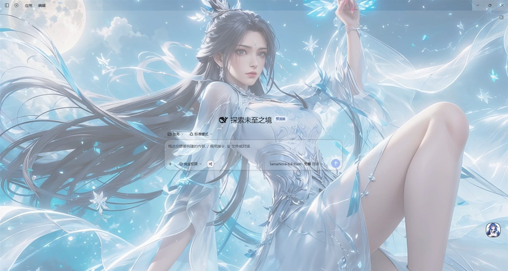
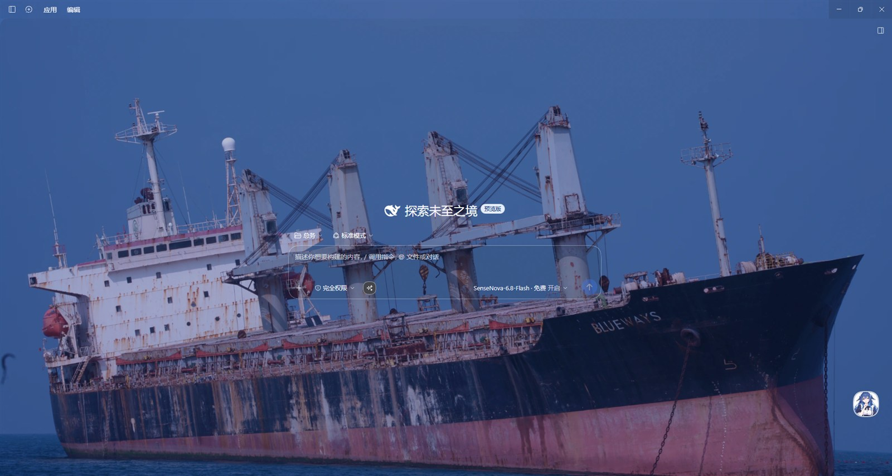
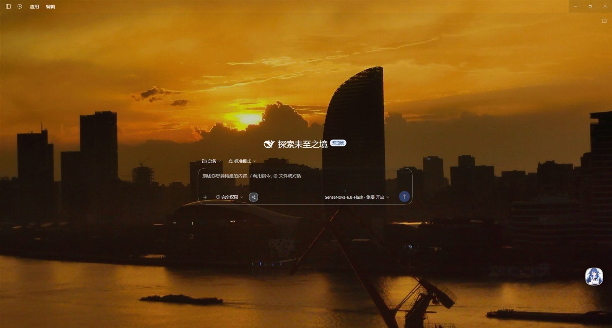
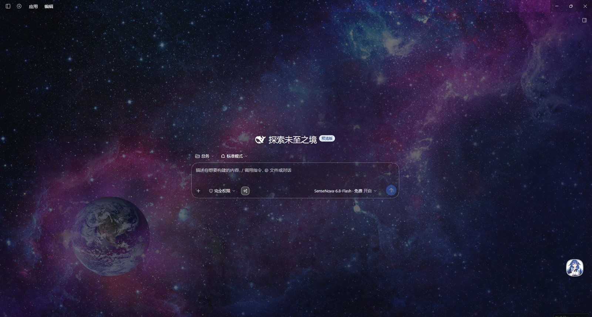

# dsh-skin · Skinning for the DeepSeek Harness desktop app

> [中文 →](README.md) ｜ **English**

Put a **full-screen background image** behind the DeepSeek Harness desktop app — and let the plugin **flip the whole text palette to black or white based on the image's own luminance**, so the text stays readable no matter how busy the picture is.

- Switch wallpapers freely: import one image or a whole folder, or auto-rotate on a timer.
- Text always readable: the plugin measures light and dark areas of the picture and flips the palette to black or white — **never a third colour**.
- Pick your own chime: 4 bundled sounds, or add your own audio (rings when a task finishes **and** when it needs your judgement).
- Everything is a **local file**: no network calls, nothing uploaded, nothing lost on restart.

Package name `@local/dsh-skin`｜Shown in the UI as **换肤（Skin）**｜License [MIT](LICENSE)

## Screenshots

One UI, four wallpapers with very different luminance — the text stays legible in all of them (real captures):

| Ethereal light blue (light wallpaper) | Ocean vessel BLUEWAYS (dark wallpaper) |
|---|---|
|  |  |

| Sunset city (warm dark scene) | Nebula earth (deep purple dark scene) |
|---|---|
|  |  |

> That small round ball at the bottom-right is the plugin: click to open the panel, double-click to toggle auto-rotate, drop an image on it to import.

---

## Contents

- [Screenshots](#screenshots)
- [1. What it does](#1-what-it-does)
- [2. Why](#2-why)
- [3. Install](#3-install)
- [4. Using it](#4-using-it)
- [5. Why the text colour changes by itself](#5-why-the-text-colour-changes-by-itself)
- [6. The panel, item by item](#6-the-panel-item-by-item)
- [7. Where data lives](#7-where-data-lives)
- [8. Docs](#8-docs)
- [9. Repo layout](#9-repo-layout)
- [10. For developers: verification scripts](#10-for-developers-verification-scripts)
- [11. FAQ](#11-faq)
- [12. Third-party assets](#12-third-party-assets)

---

## 1. What it does

| Feature | Details |
|---|---|
| **Background image** | Pick one image or import a whole folder; landscape images fill the screen, portrait images support "original / centre / cover / blurred fill / side portrait", with a configurable blur transition on both sides |
| **Automatic text colour** | Splits the image into a **12×12 grid** and measures dark vs light area → mostly dark ⇒ **white text**, mostly light ⇒ **black text**, balanced ⇒ follow the app theme. **Only black and white** — no third colour |
| **Brightness (wash) slider** | **0–40 %**: left = show the photo, right = make the text clearer. Each image computes a *suggested minimum* shown under the slider — **a hint only, it never blocks you** |
| **Three usage modes** | **Focus 35 %** / **Normal** (per image: dark 12 % / light 6 %, still adjustable) / **Leisure 5 %** |
| **Floating ball + panel** | Click to open the panel, double-click to toggle auto-rotate (a green dot appears), drag it anywhere (remembered), drop an image file on it to import |
| **Auto-rotate** | Choose an interval (1 / 5 / 15 / 30 / 60 min) to cycle through the library |
| **Bilingual UI** | Top of the panel: 中文 / Chinese｜English / 英文 — one click, **Chinese by default**, remembered |
| **First-run guide** | A new install gets a 4-step guide when the panel first opens; a "Guide" button brings it back |
| **Completion chime** | Rings in **two situations**: ① a task really finished ② **the agent needs your judgement** (a tool asks for approval, or asks you a question) |
| **Custom sounds** | Built-in synthesised "ding" + **4 bundled small sounds**; add your own in bulk (≤8 MB each, ≤30 files, ≤200 MB total) |
| **One-click restore** | "Restore default look" removes the background and all colour changes — **your library is kept** |

## 2. Why

The app's themes are designed for flat colours: **the moment you put a photo with real light and dark areas behind the UI, some text becomes white-on-white or black-on-black.** The usual workaround is a heavy dark overlay, which flattens the photo.

This plugin hands the decision to the image itself: it first works out which parts of the picture are dark and which are light, then flips the entire text palette towards the side with more contrast, using as little wash as possible to keep the photo intact. Hence:

- the background is **barely washed** by default (only Focus mode goes to 35 %);
- text is **either all black or all white** — two colours are far easier to keep legible everywhere;
- every number in the panel is **explainable** (see §6) — no magic constants.

## 3. Install

### Option A — install from inside the app

1. Open the **Plugins** page in the desktop app.
2. Click **Add** in the top-right corner and enter the source (local folder / package name / repository URL — depends on how it was published).
3. **Restart the desktop app.**

### Option B — manual

1. Copy this repo's **`plugin/`** folder to
   `%USERPROFILE%\.dsh\profiles\desktop\node_modules\@local\dsh-skin\`
2. Open `%USERPROFILE%\.dsh\profiles\desktop\cordis.patch.yml` and add (replace the three paths with your own; the folders are created for you):

```yaml
- insert:
    - id: dsh-skin
      name: '@local/dsh-skin'
      config:
        stateFile: 'D:/dsh-skin/state.json'
        libraryFile: 'D:/dsh-skin/library.json'
        imageDir: 'D:/dsh-skin/images'
```

3. **Restart the desktop app.**

### How to confirm it worked

The settings page shows a **换肤（Skin）** section, and a **floating ball** appears near the input box on the right.

## 4. Using it

| Action | Result |
|---|---|
| **Click the ball** | Open / close the panel |
| **Double-click** | Toggle auto-rotate (a **green dot** means on) |
| **Drag it** | Move it; the position is **remembered** across restarts |
| **Drop an image on it** | Import that image |
| **Esc / click outside** | Close the panel |

## 5. Why the text colour changes by itself

1. Scale the background image down to a **12×12 grid** and measure each cell's average luminance.
2. Count the "rather dark" and "rather light" cells (plus the image's overall mean and dominant colour).
3. Decide the text palette: mostly dark cells ⇒ **white text**; mostly light ⇒ **black text**; balanced ⇒ follow the theme (dark theme ⇒ white, light theme ⇒ black).

**Why only two colours**: there used to be an exception ("blue text on light backgrounds"); measured on a light image it gave **2.55:1** contrast where black text gives **11.22:1** — strictly worse, so it was removed. One colour fewer, but every pixel readable.

## 6. The panel, item by item

From top to bottom:

1. **Language / 语言** — 中文 / Chinese｜English / 英文, one click (Chinese by default)
2. **Guide** button — reopen the first-run guide at any time
3. **Restore default look** — removes background and colours (keeps the library, the language and the chime switch)
4. **Usage mode** — Focus / Normal / Leisure (Focus and Leisure lock the slider below and say why)
5. **Brightness** — 0–40 % slider plus a "suggested minimum" hint
6. **Library** — thumbnails (60 rendered at a time, more as you scroll), shuffle, pick images, pick a folder
7. **Portrait fill** — original / centre / cover / blurred fill / side portrait + side blur transition
8. **Auto-rotate** — interval (off / 1 / 5 / 15 / 30 / 60 min)
9. **Completion chime** — switch / volume / test / add sounds (multi-select) / sound list / storage readout
10. **This image** — darkness, luminance, suggested minimum

> **The chime only works after you press "Test" once** — browsers refuse to play audio before the user has clicked.

## 7. Where data lives

| What | Where |
|---|---|
| Settings | the `state.json` you configured |
| Library index | the `library.json` you configured |
| Images | the `images/` folder you configured (two files per image: original + thumbnail) |
| Custom sounds | `sounds/` next to the image folder (`index.json` + one file per sound) |

All of it is **local** — none of it is in this repository, and none of it is uploaded.

## 8. Docs

| Doc | For |
|---|---|
| [`plugin/docs/操作指引.md`](plugin/docs/操作指引.md) | **First-time users**: 30-second start, install, ball gestures, panel, FAQ, English quick start |
| [`plugin/docs/使用说明.md`](plugin/docs/使用说明.md) | Users: the full manual (Chinese) |
| [`plugin/docs/版本记录.md`](plugin/docs/版本记录.md) | Changelog: what changed and why (Chinese) |
| [`plugin/docs/踩坑与设计决策.md`](plugin/docs/踩坑与设计决策.md) | **Anyone changing the code**: every past mistake, the reasoning behind each decision, how to verify |

## 9. Repo layout

```
.
├── plugin/                  ← the folder that gets installed
│   ├── index.js             ← host half: local HTTP routes, file IO, state decisions
│   ├── client.js            ← page half: wash, ink flipping, floating ball and panel
│   ├── cordis.patch.yml     ← registration (placeholder paths — edit for your machine)
│   ├── package.json / icon.svg / locale/
│   ├── assets/sounds/       ← the 4 bundled sounds
│   └── docs/                ← bundled docs (same source as §8)
├── assets/demo/             ← the 4 screenshots on this page (not part of the install)
├── verify/                  ← offline verification scripts (assertions extracted from source)
├── releases/                ← per-version rollback snapshots + SHA256 file lists
├── LICENSE                  ← MIT
├── README.md                ← Chinese
└── README.en.md             ← this file
```

## 10. For developers: verification scripts

Everything under `verify/` runs offline (`node verify/xxx.cjs`). The guiding rule: **assertions are extracted from the source, never copy-pasted constants** — otherwise the tests stay green after you break the code.

```powershell
node verify/full_verify.cjs        # full contract of the page logic (runs it against a React stub)
node verify/panel_order_check.cjs  # panel section order + zh/en dictionaries must have identical keys
node verify/bell_check.cjs         # the whole chime chain (including "needs your judgement")
node verify/bell_signal_check.cjs  # when it must ring / when it must stay silent
node verify/mode_wash_check.cjs    # wash values for the three modes
node verify/sound_quota_check.cjs  # the three sound limits + first-run seeding + brand sounds auto-removed
node verify/version_check.cjs      # package version ↔ snapshot hashes ↔ UI title
```

- `wash_audit`, `static_surface_audit`, `solid_fill_check`, `ctx_tokens` and `theme_apply_probe` read `app.asar` from the desktop app's install directory (`%LOCALAPPDATA%\Programs\DeepSeek Harness\resources\app.asar`). Installed elsewhere they will simply fail to read — **they never modify anything**.
- `full_verify` falls back to **built-in sample data** when `state.json` / `library.json` are absent, so it runs right after a clone.

## 11. FAQ

**Nothing happened after installing?** Restart the desktop app, then check that the settings page shows 换肤（Skin）.

**The floating ball is gone?** It may have been dragged into a corner. Restarting brings it back near the input box (the dragged position is remembered on purpose).

**Text is hard to read after switching images?** Drag the brightness slider right. The plugin already picks black or white for you — if it is still hard, the photo is simply too busy.

**Will my image library be lost?** No. Images and index are local files. "Restore default look" only removes the background and colours.

**The chime does not ring?** ① the switch is off; ② you never pressed **Test** (browsers need one click first); ③ no custom sound is selected (the list item needs a `✓`).

**The chime rings at the wrong moment?** It only rings in two cases: **a task really finished**, or **the agent needs your judgement** (approval / a question). If you believe it misfired, note what was happening and how early it rang, and open an issue.

**"Storage limit" when adding sounds?** Limits: 8 MB per file, 30 files, 200 MB total. A 1–3 second notification mp3 is usually only tens of KB.

**Can I keep the image but not flip the text?** Not separately — ink flipping is the point of this plugin. For a raw photo, set brightness to 0 and accept that some text may become hard to read.

## 12. Third-party assets

The 4 bundled sounds in `plugin/assets/sounds/` (a ding, a double-bump, a coin drop, a sword-draw) are **simple synthesised/recorded notification tones, included for demonstration and personal use only** — none of them is a third-party branded audio clip. If you plan to use this repository commercially or redistribute it, replace these files with your own.

**About the version snapshots (`releases/`)**: the per-version rollback snapshots are kept here. **v1.5.2 – v1.5.5 used to ship 5 recognisable branded sounds** (the ones named after CS / QQ). **From v1.6.0 this repository no longer distributes them** — those snapshots **no longer contain** the audio files, and each snapshot's file manifest records it with a "(N branded sounds, removed)" row. The sound files still present in the snapshots are the unbranded ones.

The plugin's own code and documentation are licensed under [MIT](LICENSE).